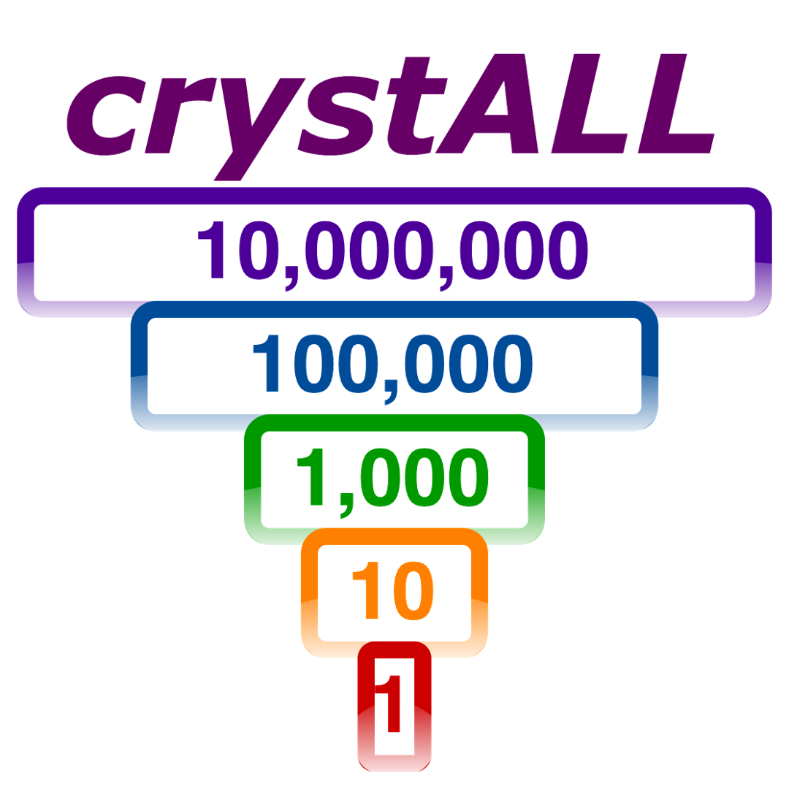
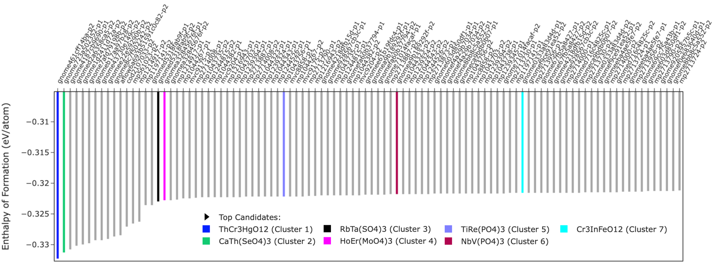
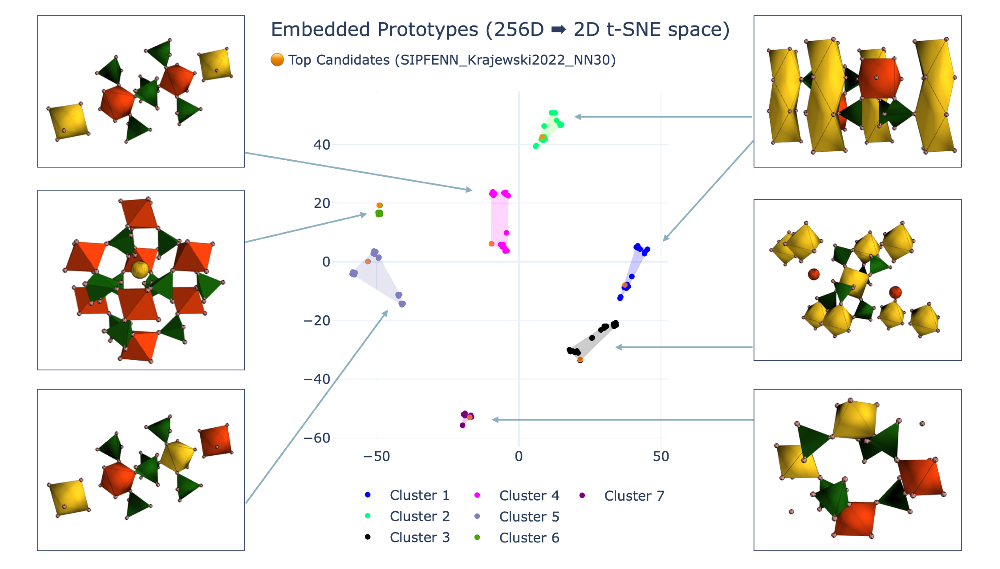

<div align="center">
<table>
  <tr>
    <td width="160">
      
    </td>
    <td style="vertical-align: middle;">
      <!-- Badges go here -->
      <a href="https://doi.org/10.xxxx/xxxxx"></a>
      <a href="https://arxiv.org/abs/YYMM.xxxxx"></a>
      
      <br>
      
      
      
      
      <br>
      
      <a href="https://pypi.org/project/crystALL"></a>
      <a href="https://anaconda.org/conda-forge/crystALL"></a>
    </td>
  </tr>
</table>
</div>
<br>


# Summary

**crystALL** is an open-source data-driven framework for atomic structure prediction and materials discovery, designed to address the critical gap between computational predictions and experimental observations. Unlike methods focused solely on stable ground states, crystALL systematically embraces structural diversity and compositional uncertainty, enabling the discovery, modeling, and validation of both stable and metastable crystal configurations.

By leveraging millions of relaxed and experimental structures from the MPDD database and OPTIMADE API, crystALL rapidly generates wide ensembles of candidate configurations for target compositions or compositional ranges. These candidates undergo atomic substitution, advanced machine learning-based featurization, clustering, and multi-model property prediction, supporting robust selection and direct ab initio or experimental validation.

crystALL uniquely supports searches accommodating experimental uncertainty and complex materials systems, generating unbiased, ensemble-focused predictions suitable for high-throughput candidate selection, statistical modeling, and validation against experiment or DFT.


# Installation

Installing **crystALL** is simple and easy by utilizing **PyPI** package repository, **conda-forge**  package repository, or by cloning from **GitHub** directly. While not required, it is recommended to first set up a virtual environment using venv or Conda. This ensures that (a) one of the required versions of Python (3.11+) is used and (b) there are no dependency conflicts. If you have Conda installed on your system (see [`miniconda` install instructions](https://docs.conda.io/en/latest/miniconda.html)), you can create a new environment using:

``` shell
conda create -n crystall python=3.11
conda activate crystall
```

Then install **crystALL** (regular)
``` shell
pip install crystall
```
Or for editable install (development)
``` shell
pip install -e .
```

🚧 **Linux users:** First install DGL for torch >=2.3 🚧
``` shell
python -m pip install "dgl>=2.2.0" -f https://data.dgl.ai/wheels/torch-2.3/repo.html
pip install crystall
```


# Features

**crystALL** provides a practical, science‑driven pipeline to generate, featurize, and prioritize candidate crystal structures for a target composition. At a high level the workflow gathers prototype structures (from local files or MPDD), computes consistent ML descriptors, applies one or more property predictors, and selects compact, experimentally actionable candidate sets.

Prototype generation and featurization are designed to be reproducible and lightweight: the code performs anonymized elemental substitutions and deduplication to build a controlled prototype ensemble (the default generation is intentionally constrained). Each prototype is then embedded into KS2022 descriptor space via pySIPFENN, yielding a uniform representation suitable for clustering and downstream models.

To illustrate the scoring step, the bar plot below shows formation energies sorted from lowest to highest for a focused ensemble of 100 NaMg(BH4)3 prototypes. This view helps rapidly identify low‑energy regions in the ensemble and informs which clusters deserve further attention.

<div align="center">
  
</div>

Property prediction in crystALL is modular. pySIPFENN models are available natively and external calculators plug in through adapter classes. ALIGNN and CHGNet are provided as examples of such adapters: ALIGNN exposes multi‑head formation energy outputs (MP and JARVIS) which we filter according to user request, and CHGNet reports static and relaxed energies computed independently so users can skip relaxation when it is not needed. The adapters accept an explicit list of objectives, enabling selective computation and reduced runtime for expensive predictors.

After featurization and property assignment, crystALL clusters the prototype ensemble (t‑SNE for embedding + KMeans/DBSCAN for grouping) and annotates clusters with objective statistics. The figure below shows the t‑SNE embedding for the same NaMg(BH4)3 set: seven clusters are recovered and correspond to distinct structural families (for example, clusters 1 and 2 are enriched in hexagonal motifs, cluster 3 in triclinic arrangements, clusters 4, 5 and 7 in trigonal lattices, and cluster 6 contains perovskite‑type geometries). This separation illustrates how descriptor‑based clustering can disentangle fundamentally different local chemistries and geometries.

<div align="center">
  
</div>

The final selection step produces Top Candidates by selecting the lowest‑energy representative from each cluster for every available objective; these candidates provide a compact, diverse set for higher‑accuracy DFT relaxation or experimental validation. Outputs are exportable as CSV (`all-prototypes` and `top-candidates`), and an optional MPDD convex‑hull check (energy‑above‑hull) can be performed to further prioritize thermodynamically plausible entries.


# Tutorials

If you would like to try **crystALL**'s functionalities in a reproducible, hands-on environment, we provide a pre-configured GitHub Codespace with all required dependencies and local-access to MPDD database for running our tutorials:

   [](https://codespaces.new/PhasesResearchLab/crystALL?quickstart=1)

1. Click the button above to launch a ready-to-use, cloud-based workspace.
2. Once your Codespace loads, navigate to the `tutorial` directory to find curated Jupyter notebooks illustrating the main features and scientific workflows.
3. Open any notebook and execute cells interactively to explore candidate structure generation, ML-powered predictions, and data-driven analysis.


# Contributing

We welcome contributions from the wider scientific community and appreciate bug reports/fixes, documentation improvements, new adapters/models, and larger feature proposals.

For coding contributions, fork the repository, create a topic branch, and open a pull request (PR) against `main`. Please follow the project's linters/formatters (Black/flake8/isort), add type hints and clear docstrings for public APIs, include pytest tests (prefer existing fixtures), and avoid adding large dependencies without prior discussion.

If reporting a bug or requesting a feature, please open an issue with a minimal reproduction (code snippet or dataset), environment details, and the expected vs actual behaviour; users may also raise questions and contribute to discussions via issues. 

**Adding property-prediction models via calculator adapters:**
Extending crystALL with new property predictors is welcome. We integrate models as *calculator adapters* so the rest of the codebase can call different predictor objectives via a uniform interface (see `alignn.py` and `chgnet.py`). Key requirements for adapters:

- Adapter location: Create a module under `crystall/calculators/` (one file or a small package).
- I/O contract: accept pymatgen `Structure`; document outputs in the module docstring.
- API methods: adapters must expose two public methods:
	- `run_per_structure` — run the model on a single structure and return a value or structured dict.
	- `run_on_directory` — run the adapter over many structures and support both serial and parallel execution.
- Tests & examples: include unit tests with tiny fixtures.
- Lightweight runtime: Avoid forcing heavy runtime dependencies for users who don't need them. If an adapter requires optional packages, guard imports with try/except and show a clear error message describing how to install the extras.


# Citing

**crystALL** is an open-source Python package developed by the [Phases Research Lab](https://phaseslab.com/) at The Pennsylvania State University, under the supervision of Dr. Zi-Kui Liu, and distributed under the MIT License.

If you use **crystALL** in scientific publications, please cite:

- Adam Krajewski, Ricardo Amaral, Zi-Kui Liu, et al. "Data-driven candidate structure ensemble generation beyond the convex hull with crystALL". (2025).  
  [DOI:10.xxxx/xxxxx](https://doi.org/10.xxxx/xxxxx), [arXiv:YYMM.xxxxx](https://arxiv.org/abs/YYMM.xxxxx)
