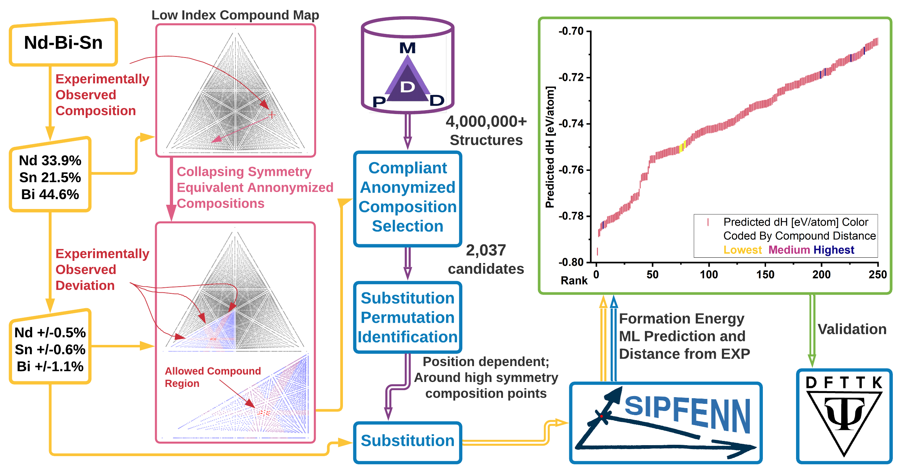

# Statement of need

The ability to determine atomic structure of existing or hypothetical solids formed by chemical elements is one of the fundamental challanges in theoritical crystallography and in materials science as a whole. For the last several decades [@Hawthorne1994], the two remaining challenges are predictions of (a) compositions forming compounds of interest and (b) candidate topologies or approximate atomic arrangements they can form. Given these, the exact structure can be solved experimentally, e.g., by matching X-ray diffraction profile to candidates using method by [@LeBail1988] and interpreting the profile, or by similar investigation of the Raman spectrum [@Ferrari2013]. For hypothetical compounds in their pure quantum states, the exact structure can also be solved using ab initio quantum mechanical methods, such as Kohn-Sham density functional theory (DFT) [@Kohn1965], which are computationally expensive but can provide accurate results and continue to improve [@Kothakonda2023].

The latter problem of proposing the topologies has been traditionally approached by finding geometries satisfying constraints, like the principles systematized by [@Pauling1929], which included then-novel concepts like coördination. Over decades, this has evolved into automated computational tools like the `GRINSP` by [@LeBail2005] which can propose such structures. More recently, increasing computational power shifted focus towards testing many options, with some of the methods starting from random arrangements and collapsing them into local minima, like `AIRSS` by [@Pickard2011], or by evolutionary techniques, like `USPEX` [@Glass2006]. 

Several efforts have been made to tackle both topological and compositional challenges simultaneously, such as high-throughput construction of the `AFLOW` [@Curtarolo2012] DFT Database [@Toher2018] (and others, see [Methods](#Methods) Section) built by systematicly populating the earlier, yet continously growing, library of prototype structures [@Mehl2016] with new chemistries based on the expert knowledge. However, even for a limited set of elements, this problem becomes combinatorically challenging [@Krajewski2024Nimplex]. This prompted recent efforts into (1) systematic similarity-driven prediction of substitutions which would result in finding new low-energy structures [@Wang2021]; (2) into brute-force substitutions filtered by machine learning models [@Schmidt2023]; and (3) the combination thereof [@Merchant2023], leading to rapid discovery of new structures stable at 0K temperature and 0Pa pressure against competing arrangements.

While finding new candidates for zero-temperature zero-pressure hypothetical structures certainly opens the world for new discoveries, it warrants some key questions. Firstly, *"To what degree have we biased the discovery of new structures?"* through many iterations of biasing the search to our expectations, which is philosophically analogous to how retraining Large Language Models (LLMs) and other machine learnig (ML) models on generated data makes them underestimate improbable events causing, so called, *Model Collapse* [@Shumailov2023], and drift from the real distribution of the data [@Alemohammad2023]. 

In case the data becomes biased towards low-energy solutions, one needs to ask *"Do we need the diverse energy landscapes to discover new materials?"* to which the answer is a multifaceted yes.

# Summary

`crystALL` is a concise computational tool which leverages millions of previously calculated structures from authors' [MPDD](#MPDD-Database) Database and other databases accessed through the OPTIMADE API [@Evans2024] to identify structures of target stoichiometry and perform all permutations of substitutions to arrive at a list of candidate structures. This list 

- (2 sentences) Motivation for materials discovery
    - CALPHAD [@Olson2023]
    - Going beyond stability. It is not enough [@Zunger2019] because of the complexities involved in the synthesis of new materials. Phase coexistance can take properties to extreme, e.g. infinitely negative thermal expansion [@Liu2022]. Superconductors [@Ferreira2023]
- Typically done through combinatoric search based on protoypes and DFT
    - Similarity driven prediction of substitutions 
    - Compositional complexity grows quickly with dimensionality, considering thhat substitutions 

- (3 sentences) Past deployment on the Nd-Bi system [@Im2022] and Figure 7a of [@Im2022] showing excellent ordering of the candidates when evaluated vs different DFT methods. Past deployment in Al-Fe [@Shang2021].

- Motivation slightly reiterating the summary with more focus on impact and need
- (**Rushi**, 3 sentences) *(Importance of Ru-Zn in the study of catalysts. Importance of KCl-LaCl3 system in the study of molten salts. How `crystALL` is continuously used in the lab to predict structures of unknown compounds and if the automated experience has been positive.)*
To enhance nylon manufacturing efficiency, Ru-based catalysts are recognized as highly effective catalysts in synthesizing the key chemical intermediate through the benzene partial hydrogenation reaction [@Zhang2013]. Achieving precise control over this process is important to ensure optimal outcomes. Improvement of hydrogenation selectivity involves designing diverse active site ensembles in intermetallic catalysts [@Dasgupta2022]. Using crystALL, we have explored over 165, 000 configurations of Ru-Zn intermetallic compounds, including Ru${_3}$Zn, RuZn, Ru${_4}$Zn${_9}$, RuZn${_3}$, Ru${_3}$Zn$_{10}$, RuZn${_6}$, RuZn$_{10}$, and RuZn$_{13}$. We are currently examining their structures and stability through pySIPFENN [@Krajewski2022], while simultaneously evaluating active site ensembles to design novel catalysts with high activity and selectivity. In the journey towards clean energy and carbon footprint reduction, the development of Molten Salt Reactors (MSRs) is essential, which requires high reliability and efficiency. crystALL serves as a valuable tool for identifying structures for complex molten salts, particularly in cases of limited or conflicting experimental data. For example, crystALL facilitated the prediction of structures for KLa${_3}$Cl$_{10}$ and K${_3}$La${_5}$Cl$_{18}$ compounds in the KCl-LaCl${_3}$ system, thereby validating their stability reported in various literature sources [@Seifert1985] [@Song1995].
- (**Adam**, 1 sentence) Conclusion on the importance of automation for user tool.

# Methods

## MPDD Database

The `MPDD` or Materials-Properties-Descriptors Database is an infrastructure combining a growing collection of millions of atomic structures with a number of optimizations for rapid featurization and deployment of ML models. It includes author's own DFT data, as well as a number of other databases, including the `OQMD` [@Shen2022], `AFLOW` [@Toher2018], `MP` or Materials Project [@Jain2013], `NIST-JARVIS` [@Choudhary2020], `COD` [@Grazulis2019], and `GNoME` [@Merchant2023]. The database is accessible through (a) a restricted high-throughput API serving enabling fetching of several thousand structures per second, and (b) a public OPTIMADE API [@Evans2024] with low-throughput access but compatibility with other databases. Internally, the data is largely handled using modified `pymatgen` [@Ong2013] kept up-to-date with upstream changes, to ensure wide compatibility with other tools in the field.

## Predictive Modeling Pipeline

(about the pySIPFENN, MPDD-ALIGNN, and other models)

- pySIPFENN software [@Krajewski2022] and models on Zenodo [@Krajewski2020SIPFENNModels]
- ALIGNN [@Choudhary2021]

(schematic of crystALL software)

## Compound-Based Structure Prediction

(about the structure prediction)

![Compound-Based Structure Search. Reproduced from [@Im2022] under permission. \label{fig:compoundSearch}](assets/NdBi2_GraphicalAbstract_V4.png){width="300pt"}

## Composition-Based Structure Prediction

(uncertainty in compound composition extends the previous method)

{width="300pt"}

# Acknowledgements

- (a loooot of grants over 5 years: NSF superalloys, PSU Seed, all from Nd-Bi study, DOE ARPA-E, NSF-POSE, ONR FGM)
- All Phases Research Lab members who tested the software in production
- All Phases Research Lab members who provided feedback on the software

# References
